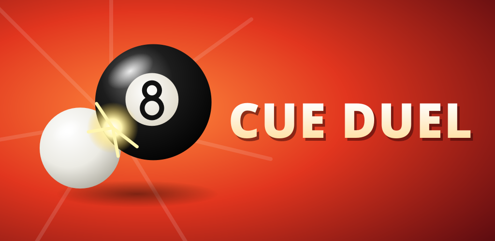

# Cue Duel

8-ball pool for Android, played against the computer or a friend on the same phone.



## Features

- 3D table with a top view and a camera behind the cue, three graphics levels
- Computer opponent with four levels. Hard and Pro play every candidate shot through
  the simulation and care about where the cue ball ends up.
- Two players on one device
- Online games for two. One phone hosts and gets a room code, the other joins with the
  code or picks the game from the list. Games can have a password. The moves are passed
  on by a small relay on the lobby server, so no router setup is needed
- 8-ball rules: break, open table, fouls (cue ball potted, wrong ball first, no rail
  after contact), ball in hand, 8 on the break goes back on the spot
- Replays of the last 12 games
- Statistics per AI level
- English, German, Spanish and Turkish
- No ads, no tracking, no servers. Internet is only used for games you host or join yourself

## Building

The game is written in Java with [libGDX](https://libgdx.com/). It needs JDK 17 or newer
and, for the app, an Android SDK (`sdk.dir` in `local.properties`).

```
./gradlew :desktop:jar
./gradlew :android:apk
```

The desktop jar lands in `desktop/build/libs`, the unsigned APK in `android/build/libs`.
`tools/sign.sh` signs the APK with the release key into `dist/`.

`tools/gen_assets.py` creates the ball textures and sounds (needs Pillow).

## Testing

Physics, rules and the AI run without graphics. The test lets the AI play itself on every
level and checks that games finish, balls stay on the table and the simulation is
deterministic:

```
./gradlew :core:simTest
```

The desktop build takes a few switches for testing:

```
java -jar desktop/build/libs/CueDuel-desktop-*.jar --play --autoplay --speed=4
```

`--play[=duo]`, `--level=N`, `--top`, `--lang=xx`, `--open=<menu>`, `--autoplay`, `--speed=N`,
`--shots=sec,...` (screenshots into the working directory), `--quit=sec`,
`--net-host=name,password`, `--net-code=code,password`, `--net-shoot`.

## Lobby server

`lobby-server/` holds the list of open games and the relay, see its README.

## License

GPL-3.0, see [LICENSE](LICENSE). Privacy policy: [PRIVACY.md](PRIVACY.md).
